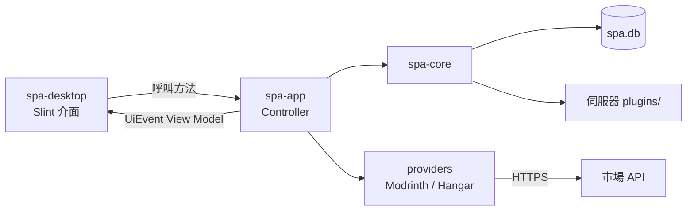

# 架構

> 最後修改：2026-11-11 ｜ 基於 commit：`dce44c0`

Smart Plugin Assistant 的完全 Rust 重寫版，取代原本的 Java／JavaFX 實作（保留在 `javafx` 分支）。功能與安全設計以 Smart Plugin Assistant Sol（JavaFX 版的後續改寫）為規格，並加回 JavaFX 版的 Hangar 支援。管理虛擬的 Minecraft 伺服器實例，從 Modrinth 與 Hangar 搜尋、安裝插件，匯入既有 JAR，並安全地更新與匯出。不會啟動或停止伺服器。



## 設計原則

- UI 框架使用 Slint，前後端嚴格分離，方便日後更換 UI 框架。
- 內建平台只有 Modrinth 與 Hangar；不包含 Sol 的 Spigot 與 JavaFX 版的 Voxel。
- 擴充方式是編譯期的 trait 實作，各平台一個 crate，不支援執行期載入外掛。
- 資料目錄 `~/.smartpluginassistant-rust/`，不與 JavaFX 版的 `~/.smartpluginassistant/` 共用。所有資料存放於單一 SQLite 資料庫 `spa.db`，並記錄明確的存檔格式版本；Sol 的 JSON 只在首次建立時匯入一次。
- 新實例的預設核心為 Paper。

## 分層

```text
spa-api  <-  providers/modrinth, providers/hangar
spa-api  <-  spa-core  <-  spa-app  <-  spa-desktop (Slint)
```

- `spa-api`：`PluginProvider` trait（阻塞式、`Send + Sync`）與不可變的資料契約。`HttpTransport` 只允許 HTTPS（測試可用 loopback HTTP）、不自動轉址、回應上限 8 MiB，並以 semaphore 限制最多 4 個同時請求。
- `spa-core`：所有碰觸磁碟或下載的功能，不引用 provider 或 UI。
- `spa-app`：`Controller` 持有狀態，從背景執行緒透過 `Sink`（`Arc<dyn Fn(UiEvent) + Send + Sync>`）送出 `UiEvent`。翻譯、設定（含允許範圍，例如 `IMAGE_CACHE_MB`）、探索清單、圖片解碼、環境選項規則、匯出預設檔名（`Controller::export_file_name`）與日誌初始化（`logging::init`）都在這裡，不含任何 UI 型別。
- `spa-desktop`：在事件迴圈（`invoke_from_event_loop`）把事件轉成 Slint model，並把介面回呼接到 Controller 方法。檔案對話框（`rfd`）與開啟資料夾／網址（`open`）也在這裡。輸入元件的範圍從 `spa-app` 的常數取得，不在介面層另外寫死或夾值，驗證一律由 Controller 執行。

## 資料安全

- 實例以 UUID 識別並集中建立索引；解除管理不刪除任何檔案。
- 程序鎖 `application.lock`（`File::try_lock`）防止多個程式同時寫入。
- `spa_core::db::Database` 以 mutex 包住一個 SQLite 連線，每次變更都在 immediate transaction 內完成。資料表、存檔格式版本與遷移流程見 [開發說明](PROJECT-DEV.md#資料儲存)。
- 下載：
  - 暫存檔放在 plugins 目錄內（`.spa-download-*.tmp`），與目標在同一磁碟區。
  - 自行處理轉址，最多 5 次，不可由 HTTPS 降級。
  - 單檔上限 256 MiB，並檢查實際長度是否符合宣告的長度，避免截斷。
  - 比對 provider 提供的大小與雜湊，再完整讀取 JAR 結構（解壓後上限 1 GiB）。
- 發布檔案使用 `persist_noclobber`，不覆寫既有檔案；被取代的檔案移到同一磁碟區的 `.spa-backups/<UUID>/`。中繼資料寫入失敗時，已搬動的檔案會移回原處。
- 插件身分綁定 SHA-512；改名的檔案只有在雜湊唯一相符時才保留原身分。
- 更新判斷使用發布 ID 與發布時間，不比較版本字串。
- 插件變更由 `PluginFiles` 的 mutex 與 Controller 的忙碌旗標序列化。
- `plugins.updated_at`：安裝、更新與匯入時寫入當下時間；未知的檔案使用修改時間。`plugins.checked_at`：成功檢查更新時依 SHA-512 寫入；檢查失敗保留舊值。

## 平台轉接

### Modrinth

沿用 Sol 的實作：

- 以載入器與遊戲版本 facet 搜尋，版本清單經過篩選，可取得指定的發布版本。
- 依賴分為必要、選用與不相容。
- 以 SHA-512 對多檔案發布辨識身分。
- 網址只接受 `modrinth.com/plugin/<slug>[/version/<id>]`。
- 環境清單來自 `tag/loader` 與 `tag/game_version`。

### Hangar

API 為 `https://hangar.papermc.io/api/v1/`：

- 平台由實例的有效載入器決定：paper／purpur／folia → PAPER，waterfall／bungeecord → WATERFALL，velocity → VELOCITY。其他載入器沒有 Hangar 結果，這不是錯誤。
- 搜尋 `projects?platform&version&offset&limit`；空白搜尋時加上 `sort=-downloads`。
- 版本清單 `projects/{id}/versions?platform&platformVersion`；指定版本使用 `projects/{id}/versions/{id|name}` 與 `versions/{id}`。發布 ID 是數字版本 ID，官方網址中可能是版本名稱。
- `platformDependencies[platform]` 列出支援的 Minecraft 版本。只有實例的有效載入器包含該平台名稱時才標為 `Verified`；否則為 `Declared`，安裝前需要使用者確認。
- 頻道：有 UNSTABLE 標記或名稱類似 snapshot／dev／beta／rc 的視為 Beta，含 alpha 的視為 Alpha，其餘為正式版。
- 驗證 `fileInfo.sha256Hash`；只提供外部網址的檔案沒有直接下載。
- `pluginDependencies` 有 `projectId` 的經 Hangar 解析；只有網站連結的依賴成為 `ManualDependency` 項目，需要明確確認，不會被默默略過。
- Hangar 沒有以雜湊查詢的 API，本機 JAR 辨識只使用 Modrinth。

## 探索清單

- `ProjectFeed` 保存查詢條件與目標環境的快照，以「平台＋專案」去除重複。只有成功接收的頁面才前進；遇到空白頁、全部重複或最後一頁即停止。
- 每個清單同時只有一個請求。切換來源、查詢或實例，或離開分頁時，以 session token 丟棄過期的結果。
- 失敗時保留已顯示的項目，需要明確重試。
- Slint 清單在剩餘內容高度低於 300 px 時（`changed content-y`）請求下一頁，另有「載入更多」按鈕作為備援。
- Provider 的頁碼從 0 開始。

## 圖片與設定

- `ImageCache`（core）：
  - 只保存驗證過的點陣圖（檢查 PNG／JPEG／GIF／BMP／WebP 檔頭，每張上限 4 MiB），檔名為 `<sha256>.img`。
  - 相同請求合併，由 4 個 worker 處理，佇列上限 80 個工作。
  - 七天滑動有效期；重新下載失敗時沿用舊圖。
  - 超過容量上限時刪除最久未使用的檔案。
  - 清理或停用時以世代計數器隔離進行中的寫入。
- `spa-app::artwork` 解碼第一個影格，限制尺寸與記憶體配置，縮成 128 px RGBA，記憶體快取 128 張。
- 設定的欄位與驗證見 [開發說明](PROJECT-DEV.md#設定)。

## 介面實作

- 翻譯：Slint 的 `Tr.get(Tr.revision, key)` 是 pure callback；遞增 `revision` 會重新計算所有文字。
- 對話框是視窗內的 modal，由 `dialog` 屬性選擇。訊息框是獨立的最上層，錯誤訊息不會讓填到一半的表單消失。
- 已安裝插件表格：
  - 欄位為固定寬度，放在可水平捲動的 `ScrollView` 內。
  - 拖曳標題右側邊界時只更新 Slint model（`column-drag`）；放開後才呼叫 `Controller::set_column_width`，由 Controller 驗證、儲存並重新送出 `UiEvent::Columns`。
  - 欄位選擇（「欄位」按鈕或標題列右鍵）呼叫 `set_column_visible`／`reset_columns`。
- 懸浮說明：
  - `AppButton.tip` 在滑鼠停留時啟動 600 ms 的 `Timer`，停用的按鈕也會啟動。時間到後寫入 `Tip` global（文字與按鈕在視窗中的位置）。
  - MainWindow 最後繪製唯一的 `TipBox`，因此說明框不會被裁切或遮住。靠近視窗底部時改顯示在按鈕上方。
  - 說明文字是翻譯檔的 `tip.*`。
- 選單和對話框一樣是根層 overlay（匯出選單為 `export-menu`），依按鈕的 `absolute-position` 定位，以覆蓋整個視窗的 TouchArea 處理點選單外關閉。不使用 PopupWindow，離線擷取才能驗證。
- 字型沒有 ▾ 等符號，下拉箭頭以 `Path` 繪製（`AppButton.dropdown`）。
- `--snapshot=<目錄>` 安裝離線的 `MinimalSoftwareWindow` 平台與自己的事件佇列，以線上 API 驅動真實介面；`--smoke` 寫出 `smoke-result.json`。
